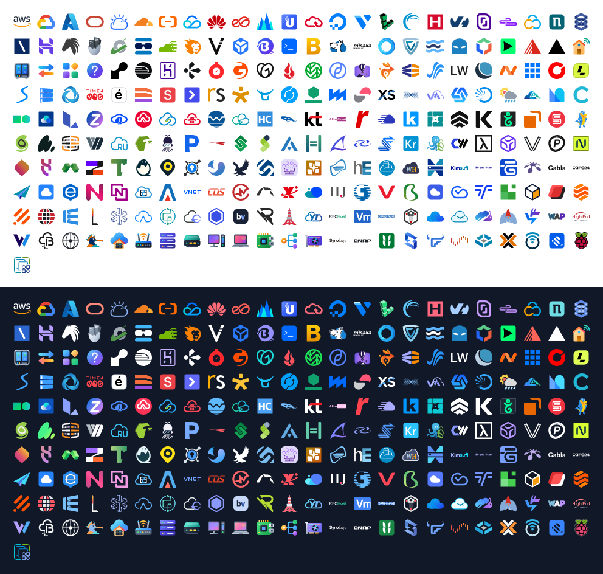
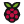

# vps-icons · 云厂商与主机图标库

面向服务器监控面板（如哪吒探针）、状态页、导航站与技术文档的独立云厂商、VPS / IDC 及通用基础设施图标库。通过 jsDelivr CDN 直接引用，也可克隆后完全离线使用。

Self-contained cloud, VPS, hosting, and generic infrastructure icons for monitoring dashboards, status pages, directories, and documentation. Load directly via jsDelivr CDN or self-host offline.

当前共收录 **241** 个图标（`vector` 156 · `redrawn` 85；全部提供 SVG 与 8 档 PNG；**197** 个含深色变体，**123** 个含小尺寸专版）。

Currently **241** icons (156 `vector`, 85 `redrawn`; all with SVG + 8 PNG sizes; **197** dark variants, **123** compact small masters).

[](https://zhdsmy.github.io/vps-icons/preview.html)

[在线交互预览 · Live preview](https://zhdsmy.github.io/vps-icons/preview.html) · [完整元数据索引 · index.json](index.json)

---

## CDN 用法 / CDN Usage

本库通过 GitHub tag + [jsDelivr](https://www.jsdelivr.com/) 分发（不发布 npm 包）。生产环境请固定版本 tag，如 `@v1.3.0`：

Distributed via GitHub tags and jsDelivr (not published to npm). Pin an immutable release tag such as `@v1.3.0` in production:

```text
https://cdn.jsdelivr.net/gh/zhdsmy/vps-icons@v1.3.0
```

### 1. 彩色图标（`` 与浅/深自适应 `<picture>`） / Color Icons

```html
<!-- 标准尺寸彩色 SVG / Standard color SVG -->


<!-- 浅/深背景自适应 + 小尺寸专版（≤ 24 px）/ Theme-aware compact SVG (<= 24 px) -->
<picture>
  <source media="(prefers-color-scheme: dark)"
          srcset="https://cdn.jsdelivr.net/gh/zhdsmy/vps-icons@v1.3.0/svg/small/color-dark/aws.svg">
  
</picture>

<!-- 固定尺寸 PNG（自动按 small.maxSize 选用小图）/ Fixed-size PNG (auto-selects small master) -->

```

> 若某个图标在 `index.json` 的 `variants.svg` 中不含 `color-dark`，深色背景直接回退到 `svg/color/<slug>.svg`（PNG 同理回退到 `png/color/<size>/<slug>.png`）。
> If `color-dark` is absent from `variants` in `index.json`, fall back to `color`.

### 2. 单色外链（CSS `mask` 跟随文字颜色） / Monochrome via CSS Mask

外链 `svg/mono/<slug>.svg`（或小尺寸 `svg/small/mono/<slug>.svg`）配合 `mask` 与 `background: currentColor`，可自动跟随父元素文字颜色：

Apply an external monochrome SVG as a CSS mask so the icon inherits `currentColor`:

```html
<span class="vps-icon" role="img" aria-label="Tencent Cloud"></span>
<style>
.vps-icon {
  display: inline-block;
  width: 1em;
  height: 1em;
  background-color: currentColor;
  -webkit-mask: url("https://cdn.jsdelivr.net/gh/zhdsmy/vps-icons@v1.3.0/svg/mono/tencent-cloud.svg") center / contain no-repeat;
  mask: url("https://cdn.jsdelivr.net/gh/zhdsmy/vps-icons@v1.3.0/svg/mono/tencent-cloud.svg") center / contain no-repeat;
}
</style>
```

### 3. 单色内联（`currentColor`） / Inline Monochrome SVG

所有 `svg/mono/<slug>.svg` 与 `svg/small/mono/<slug>.svg` 均使用 `viewBox="0 0 64 64"` 和 `fill="currentColor"`，无外部依赖，可直接内联到 HTML / JSX / Vue（以下摘自 `svg/mono/vercel.svg`）：

Every monochrome SVG uses `viewBox="0 0 64 64"` and `fill="currentColor"` with no external references, ready to inline directly (excerpt from `svg/mono/vercel.svg`):

```html
<svg xmlns="http://www.w3.org/2000/svg" fill="currentColor" viewBox="0 0 64 64" width="16" height="16" aria-hidden="true">
  <path fill="currentColor" d="M60 56.558H4L32 7.442z"/>
</svg>
```

---

## 变体与尺寸 / Variants & Sizes

| 格式 / Format | 路径 / Path | 尺寸 / Size | 说明 / Notes |
|---|---|---|---|
| SVG（标准彩色） | `svg/color/<slug>.svg` | 64 × 64 viewBox | 默认及浅色背景主图 / Default & light surfaces |
| SVG（深色彩色） | `svg/color-dark/<slug>.svg` | 64 × 64 viewBox | 仅当 `variants.svg` 包含 `color-dark` 时存在 / Only when `color-dark` is declared |
| SVG（单色） | `svg/mono/<slug>.svg` | 64 × 64 viewBox | `fill="currentColor"`，支持内联与 CSS `mask` / Inherits `currentColor` |
| SVG（小尺寸专版） | `svg/small/{color,color-dark,mono}/<slug>.svg` | 64 × 64 viewBox | 仅当 `small.maxSize` 存在时提供 / Only when `small.maxSize` is set |
| PNG（预渲染位图） | `png/{color,color-dark,mono-black,mono-white}/<size>/<slug>.png` | 16 · 24 · 32 · 48 · 64 · 128 · 256 · 512 px | `size <= small.maxSize` 时自动由 `small/` 渲染 / Auto-rendered from `small/` at small sizes |

---

## `small` 小图是什么、何时用 / Compact Small Masters

在 16 px – 32 px 的侧边栏、服务器列表、状态徽章等场景下，字标、细线条或复杂细节容易发糊、粘连或难以辨认。对这类图标，本库在 `svg/small/<variant>/<slug>.svg` 提供专门的小尺寸图稿（抽离独立图形标、精简噪点或加粗描边），并在 `index.json` 中通过 `small.maxSize`（常见为 `24` 或 `32`）声明生效阈值：

At 16–32 px (sidebars, server tables, badges), wide wordmarks, hairlines, and intricate marks lose clarity. Entries declaring `small.maxSize` (typically `24` or `32`) ship dedicated compact masters under `svg/small/` with isolated symbols, simplified geometry, or reinforced strokes:

- **引用 PNG 时（自动）**：无需额外判断，`png/<variant>/<size>/<slug>.png` 在 `size <= small.maxSize` 时已自动使用小图渲染。
  **Using PNG (automatic):** pre-rendered PNGs at `size <= small.maxSize` already use the `small/` master.
- **引用 SVG 时（按阈值切换）**：当渲染尺寸 `<= small.maxSize`（例如 16 px / 24 px 表格图标）时，加载 `svg/small/<variant>/<slug>.svg`；大于该尺寸时加载 `svg/<variant>/<slug>.svg`。未声明 `small.maxSize` 的条目全尺寸共用标准主图。
  **Using SVG (switch by threshold):** load `svg/small/<variant>/<slug>.svg` when displaying at `<= small.maxSize` px, and `svg/<variant>/<slug>.svg` above it. Entries without `small.maxSize` use the primary master at all sizes.

---

## 来源质量五档 / Quality Tiers

| 质量 / Quality | 定义 / Definition |
|---|---|
| `vector` | 官方原生矢量、已署名开源图标集原生矢量，或本库 5 个原创通用图标。 / Native vector from the brand, a credited collection, or one of this project's 5 original generic icons. |
| `redrawn` | 对照官方高清位图/站标手工重绘的干净矢量，在 64 px 与原图比对。 / Hand-redrawn vector traced from official raster artwork and verified at 64 px. |
| `raster` | 高清位图（最长边 ≥ 256 px，保留复杂渐变或阴影，仅提供 PNG）。 / High-resolution bitmap (≥ 256 px) kept as PNG-only to preserve complex shading. |
| `upscaled` | 原图最长边 ≤ 64 px，经 Lanczos 传统重采样放大（待替换清晰源）。 / Small raster original (≤ 64 px) enlarged with Lanczos resampling (better source wanted). |
| `placeholder` | 暂无可用官方图稿时以品牌色与首字母生成的占位图（待替换）。 / Brand-colored initial placeholder when official artwork is unavailable. |

---

## `index.json` 结构 / Index Schema

`index.json` 由 `src/catalog.json` 构建生成，可供前端或脚本自动检索别名、品牌色、变体与小图阈值：

`index.json` is generated from `src/catalog.json` for programmatic lookup of aliases, brand colors, available variants, and small-icon thresholds:

| 字段 / Field | 类型 / Type | 说明 / Description |
|---|---|---|
| `sizes` | `number[]` | 导出的 PNG 像素尺寸列表（`[16, 24, 32, 48, 64, 128, 256, 512]`）。 / Exported PNG widths in px. |
| `icons[]` | `object[]` | 图标条目数组。 / Array of icon records. |
| `slug` | `string` | 唯一文件名标识（小写 `kebab-case`）。 / Unique lowercase `kebab-case` identifier used in paths. |
| `name` / `names["zh-CN"]` | `string` | 英文名与中文名。品牌有官方中文名时使用官方名称，否则沿用英文名。 / English and Chinese names. Brands use their official Chinese name when available, otherwise the English name. |
| `aliases` | `string[]` | 检索键，可包含拼音。别名、常用名、slug 和英文名按 NFKC 规范化并忽略大小写、空白和标点后，不能指向不同条目。 / Search keys, including pinyin. Across entries, aliases and nicknames must be unique and cannot shadow a slug or English name after NFKC normalization and removal of case, whitespace and punctuation differences. |
| `nicknames?` | `string[]` | 中文社区常用的简称或外号。提供时至少包含一个非空字符串。 / Common names in Chinese-speaking communities. When present, contains one or more non-empty strings. |
| `website` | `string` | 厂商官网 HTTPS 链接（通用图标指向 `preview.html` 锚点）。 / Official HTTPS website (or `preview.html` anchor for generic icons). |
| `brandColor` | `string` | 十六进制品牌主色（`#RRGGBB`）。 / Primary hex brand color. |
| `source` / `monoSource?` | `string` | 主图与可选单色图的原始来源 URL（5 个原创图标为仓库内路径）。 / Provenance URL(s) for primary and optional monochrome masters. |
| `sourcePage?` / `paletteSource?` | `string` | 图源说明页与配色来源的 HTTPS 链接。 / HTTPS links to the source page and color reference. |
| `license` | `string` | 该图标对应的授权与商标说明。 / Per-icon license and trademark statement. |
| `quality` | `string` | 五档来源质量之一（`vector` \| `redrawn` \| `raster` \| `upscaled` \| `placeholder`）。 / One of the five quality tiers. |
| `processing` | `string[]` | 一次性图形整理与小图/深色处理记录。 / One-time artwork preparation notes. |
| `small` | `object` | `{ artwork, source, maxSize? }`：小尺寸处理说明、来源与可选 `maxSize` 阈值（对应 `src/catalog.json` 中的 `smallMax`）。 / Small-size provenance and optional `maxSize` threshold (from `smallMax` in `src/catalog.json`). |
| `variants` | `object` | `{ svg: string[], png: string[] }`：实际生成的变体列表；当 `src/catalog.json` 中 `hasDark: true` 时包含 `color-dark`。 / Available asset variants; includes `color-dark` when `hasDark: true` in `src/catalog.json`. |
| `nativeSize?` | `[number, number]` | 仅 `raster` / `upscaled` 条目包含的原始位图像素尺寸。 / Original pixel dimensions (only on `raster` / `upscaled` entries). |

```json
{
  "sizes": [16, 24, 32, 48, 64, 128, 256, 512],
  "icons": [
    {
      "slug": "aws",
      "name": "Amazon Web Services",
      "names": { "zh-CN": "亚马逊云科技" },
      "aliases": ["aws", "lightsail", "amazon", "yamaxun"],
      "website": "https://aws.amazon.com",
      "brandColor": "#252F3E",
      "source": "https://raw.githubusercontent.com/gilbarbara/logos/.../logos/aws.svg",
      "license": "CC0-1.0 (SVG Logos collection); brand rights reserved",
      "quality": "vector",
      "processing": ["..."],
      "small": {
        "artwork": "Compact aws wordmark ... for 16 and 24 px.",
        "source": "https://raw.githubusercontent.com/gilbarbara/logos/.../logos/aws.svg",
        "maxSize": 24
      },
      "variants": {
        "svg": ["color", "color-dark", "mono"],
        "png": ["color", "color-dark", "mono-black", "mono-white"]
      }
    }
  ]
}
```

---

## 图标目录 / Catalog

当前全部条目均已提供矢量 SVG（无 PNG-only / `upscaled` / `placeholder`）。若能为 `redrawn` 条目提供官方原生矢量源，欢迎提交 Issue 或 PR。

All current entries ship as SVG (zero PNG-only, `upscaled`, or `placeholder` icons). Official native vector upgrades for `redrawn` entries are welcome.

名称不同时并列显示英文名与中文名。常用名列列出中文社区的叫法，缺省时显示「—」。

English and Chinese names appear together when they differ. The next column lists common community names or an em dash when none are recorded.

| 图标 / Icon | 名称 / Name | 常用名 / Also known as | Slug | 深色 / Dark | 小图 / Small | 来源质量 / Quality | 来源 / Source |
|---|---|---|---|:---:|:---:|---|---|
|  | Amazon Web Services · 亚马逊云科技 | AWS | [`aws`](svg/color/aws.svg) | [✓](svg/color-dark/aws.svg) | [≤24](svg/small/color/aws.svg) | vector | [↗](https://raw.githubusercontent.com/gilbarbara/logos/b9edc65f8946027cb5e2fe6c772e914cf3649fba/logos/aws.svg) |
|  | Google Cloud | 谷歌云、GCP | [`google-cloud`](svg/color/google-cloud.svg) | — | — | vector | [↗](https://cdn.jsdelivr.net/npm/@lobehub/icons-static-svg@1.104.0/icons/googlecloud-color.svg) |
|  | Microsoft Azure · 微软智能云 Azure | 微软云 | [`azure`](svg/color/azure.svg) | — | — | vector | [↗](https://cdn.jsdelivr.net/npm/@lobehub/icons-static-svg@1.104.0/icons/azure-color.svg) |
|  | Oracle Cloud Infrastructure | 甲骨文、甲骨文云、OCI | [`oracle-cloud`](svg/color/oracle-cloud.svg) | [✓](svg/color-dark/oracle-cloud.svg) | — | vector | [↗](https://cdn.jsdelivr.net/npm/simple-icons@11.15.0/icons/oracle.svg) |
|  | IBM Cloud · IBM 云 | — | [`ibm-cloud`](svg/color/ibm-cloud.svg) | [✓](svg/color-dark/ibm-cloud.svg) | [≤24](svg/small/color/ibm-cloud.svg) | vector | [↗](https://cdn.jsdelivr.net/npm/simple-icons@11.15.0/icons/ibmcloud.svg) |
|  | Cloudflare | CF | [`cloudflare`](svg/color/cloudflare.svg) | — | — | vector | [↗](https://cdn.jsdelivr.net/npm/@lobehub/icons-static-svg@1.104.0/icons/cloudflare-color.svg) |
|  | Alibaba Cloud · 阿里云 | 阿里 | [`alibaba-cloud`](svg/color/alibaba-cloud.svg) | — | — | vector | [↗](https://cdn.jsdelivr.net/npm/@lobehub/icons-static-svg@1.104.0/icons/alibabacloud-color.svg) |
|  | Tencent Cloud · 腾讯云 | 腾讯 | [`tencent-cloud`](svg/color/tencent-cloud.svg) | — | — | vector | [↗](https://cdn.jsdelivr.net/npm/@lobehub/icons-static-svg@1.104.0/icons/tencentcloud-color.svg) |
|  | Huawei Cloud · 华为云 | — | [`huawei-cloud`](svg/color/huawei-cloud.svg) | [✓](svg/color-dark/huawei-cloud.svg) | — | vector | [↗](https://cdn.jsdelivr.net/npm/@lobehub/icons-static-svg@1.104.0/icons/huaweicloud-color.svg) |
|  | JD Cloud · 京东云 | — | [`jd-cloud`](svg/color/jd-cloud.svg) | [✓](svg/color-dark/jd-cloud.svg) | [≤24](svg/small/color/jd-cloud.svg) | vector | [↗](https://img1.jcloudcs.com/portal/header/jdcloud-logo-2021.svg) |
|  | Volcengine · 火山引擎 | — | [`volcengine`](svg/color/volcengine.svg) | — | — | vector | [↗](https://cdn.jsdelivr.net/npm/@lobehub/icons-static-svg@1.104.0/icons/volcengine-color.svg) |
|  | UCloud · 优刻得 | — | [`ucloud`](svg/color/ucloud.svg) | — | [≤24](svg/small/color/ucloud.svg) | redrawn | [↗](https://avatars.githubusercontent.com/u/14289247?v=4&s=512) |
|  | China Telecom Cloud · 天翼云 | — | [`ctyun`](svg/color/ctyun.svg) | [✓](svg/color-dark/ctyun.svg) | [≤24](svg/small/color/ctyun.svg) | vector | [↗](https://www.ctyun.cn/s/q04sv38ZSzTBF4mEHo-3dVsyWITNHb2AHhoKmmcfMQvFLURsx3V4aUR26W8PQUqCT8irIp8kNZZFmZcjQa3tK6eXmmMshjNGFvsiB8BbIGaFz_TPP8FfRddLJaCyZHeBXWsC1L62ycvoisuSuYDeDRtmnH44p_kJ) |
|  | DigitalOcean | — | [`digitalocean`](svg/color/digitalocean.svg) | — | — | vector | [↗](https://cdn.jsdelivr.net/npm/simple-icons@11.15.0/icons/digitalocean.svg) |
|  | Vultr | — | [`vultr`](svg/color/vultr.svg) | — | — | vector | [↗](https://raw.githubusercontent.com/gilbarbara/logos/b9edc65f8946027cb5e2fe6c772e914cf3649fba/logos/vultr-icon.svg) |
|  | Linode | — | [`linode`](svg/color/linode.svg) | [✓](svg/color-dark/linode.svg) | [≤24](svg/small/color/linode.svg) | vector | [↗](https://raw.githubusercontent.com/gilbarbara/logos/b9edc65f8946027cb5e2fe6c772e914cf3649fba/logos/linode.svg) |
|  | Akamai · 阿卡迈 | — | [`akamai`](svg/color/akamai.svg) | [✓](svg/color-dark/akamai.svg) | [≤24](svg/small/color/akamai.svg) | vector | [↗](https://cdn.jsdelivr.net/npm/simple-icons@11.15.0/icons/akamai.svg) |
|  | Hetzner | — | [`hetzner`](svg/color/hetzner.svg) | [✓](svg/color-dark/hetzner.svg) | — | vector | [↗](https://cdn.jsdelivr.net/npm/simple-icons@11.15.0/icons/hetzner.svg) |
|  | OVHcloud | — | [`ovhcloud`](svg/color/ovhcloud.svg) | [✓](svg/color-dark/ovhcloud.svg) | — | vector | [↗](https://cdn.jsdelivr.net/npm/simple-icons@11.15.0/icons/ovh.svg) |
|  | Scaleway | — | [`scaleway`](svg/color/scaleway.svg) | [✓](svg/color-dark/scaleway.svg) | — | vector | [↗](https://cdn.jsdelivr.net/npm/simple-icons@11.15.0/icons/scaleway.svg) |
|  | UpCloud | — | [`upcloud`](svg/color/upcloud.svg) | [✓](svg/color-dark/upcloud.svg) | [≤24](svg/small/color/upcloud.svg) | vector | [↗](https://cdn.jsdelivr.net/npm/simple-icons@11.15.0/icons/upcloud.svg) |
|  | Contabo | — | [`contabo`](svg/color/contabo.svg) | — | [≤24](svg/small/color/contabo.svg) | vector | [↗](https://cdn.contabo.com/contabo-logo-2.svg) |
|  | netcup | — | [`netcup`](svg/color/netcup.svg) | [✓](svg/color-dark/netcup.svg) | — | vector | [↗](https://cdn.jsdelivr.net/npm/simple-icons@11.15.0/icons/netcup.svg) |
|  | Kamatera | — | [`kamatera`](svg/color/kamatera.svg) | [✓](svg/color-dark/kamatera.svg) | [≤24](svg/small/color/kamatera.svg) | vector | [↗](https://www.kamatera.com/wp-content/themes/kamatera/images/Group%20666.svg) |
|  | IONOS | — | [`ionos`](svg/color/ionos.svg) | [✓](svg/color-dark/ionos.svg) | — | vector | [↗](https://www.ionos.com/favicon.svg) |
|  | Hostinger | — | [`hostinger`](svg/color/hostinger.svg) | [✓](svg/color-dark/hostinger.svg) | — | vector | [↗](https://cdn.jsdelivr.net/npm/simple-icons@11.15.0/icons/hostinger.svg) |
|  | BuyVM | — | [`buyvm`](svg/color/buyvm.svg) | [✓](svg/color-dark/buyvm.svg) | — | redrawn | [↗](https://manage.buyvm.net/assets/img/login/logo.png) |
|  | HostHatch | — | [`hosthatch`](svg/color/hosthatch.svg) | [✓](svg/color-dark/hosthatch.svg) | [≤24](svg/small/color/hosthatch.svg) | vector | [↗](https://hosthatch.com/images/favicon.svg) |
|  | CloudCone | CC | [`cloudcone`](svg/color/cloudcone.svg) | [✓](svg/color-dark/cloudcone.svg) | [≤24](svg/small/color/cloudcone.svg) | redrawn | [↗](https://cloudcone.com/wp-content/uploads/2017/05/cloudcone-logo-full.png) |
|  | RackNerd | RN | [`racknerd`](svg/color/racknerd.svg) | [✓](svg/color-dark/racknerd.svg) | — | redrawn | [↗](https://www.racknerd.com/favicon.png) |
|  | GreenCloud | 绿云 | [`greencloud`](svg/color/greencloud.svg) | — | [≤24](svg/small/color/greencloud.svg) | redrawn | [↗](https://greencloudvps.com/img/site/logo.png) |
|  | HostDare | — | [`hostdare`](svg/color/hostdare.svg) | — | — | redrawn | [↗](https://www.hostdare.com/img/logo.jpg) |
|  | V.PS | 小秘书 | [`v-ps`](svg/color/v-ps.svg) | [✓](svg/color-dark/v-ps.svg) | [≤24](svg/small/color/v-ps.svg) | vector | [↗](https://v.ps/favicon.svg) |
|  | AkileCloud | AK | [`akile`](svg/color/akile.svg) | [✓](svg/color-dark/akile.svg) | [≤24](svg/small/color/akile.svg) | vector | [↗](https://akile.ai/) |
|  | BageVM | — | [`bagevm`](svg/color/bagevm.svg) | [✓](svg/color-dark/bagevm.svg) | [≤24](svg/small/color/bagevm.svg) | redrawn | [↗](https://www.bagevm.com/templates/bagevm/assets/media/logos/logo-dark.png) |
|  | DMIT | 大妈 | [`dmit`](svg/color/dmit.svg) | — | [≤24](svg/small/color/dmit.svg) | vector | [↗](https://www.dmit.io/templates/dmit_theme_2020/dmit/assets/images/dmit_logo.svg) |
|  | BandwagonHost | 搬瓦工、瓦工 | [`bandwagonhost`](svg/color/bandwagonhost.svg) | — | — | redrawn | [↗](https://bandwagonhost.com/templates/organicbandwagon/images/logo4.png) |
|  | DogYun · 狗云 | 狗云 | [`dogyun`](svg/color/dogyun.svg) | [✓](svg/color-dark/dogyun.svg) | [≤24](svg/small/color/dogyun.svg) | redrawn | [↗](https://t.me/dogyun) |
|  | Misaka Network | — | [`misaka`](svg/color/misaka.svg) | [✓](svg/color-dark/misaka.svg) | [≤48](svg/small/color/misaka.svg) | vector | [↗](https://www.misaka.io/) |
|  | Zenlayer | — | [`zenlayer`](svg/color/zenlayer.svg) | — | — | vector | [↗](https://www.zenlayer.com/wp-content/uploads/2024/03/Icon-Blue.svg) |
|  | ColoCrossing | CCS | [`colocrossing`](svg/color/colocrossing.svg) | [✓](svg/color-dark/colocrossing.svg) | [≤24](svg/small/color/colocrossing.svg) | vector | [↗](https://www.colocrossing.com/wp-content/uploads/2026/10/ColoCrossing_website_logo-1.svg) |
|  | Evoxt · 益沃斯 | — | [`evoxt`](svg/color/evoxt.svg) | [✓](svg/color-dark/evoxt.svg) | [≤24](svg/small/color/evoxt.svg) | vector | [↗](https://evoxt.com/img/evoxtblack-icon.svg) |
|  | Spartan Host | 斯巴达 | [`spartan-host`](svg/color/spartan-host.svg) | — | — | redrawn | [↗](https://spartanhost.org/images/logo.png) |
|  | Baidu AI Cloud · 百度智能云 | — | [`baidu-cloud`](svg/color/baidu-cloud.svg) | — | — | vector | [↗](https://cdn.jsdelivr.net/npm/@lobehub/icons-static-svg@1.104.0/icons/baiducloud-color.svg) |
|  | Civo | — | [`civo`](svg/color/civo.svg) | — | — | vector | [↗](https://www.civo.com/assets-rebrand/favicons/favicon.svg) |
|  | Exoscale | — | [`exoscale`](svg/color/exoscale.svg) | [✓](svg/color-dark/exoscale.svg) | [≤24](svg/small/color/exoscale.svg) | vector | [↗](https://cdn.jsdelivr.net/npm/simple-icons@11.15.0/icons/exoscale.svg) |
|  | Vercel | — | [`vercel`](svg/color/vercel.svg) | [✓](svg/color-dark/vercel.svg) | — | vector | [↗](https://cdn.jsdelivr.net/npm/simple-icons@11.15.0/icons/vercel.svg) |
|  | Home · 家宽 | — | [`home`](svg/color/home.svg) | [✓](svg/color-dark/home.svg) | [≤24](svg/small/color/home.svg) | vector | [↗](https://github.com/microsoft/fluentui-system-icons/blob/6c2c9075cf8952ef48369b2475233b6e9761efed/assets/Home/SVG/ic_fluent_home_48_color.svg) |
|  | NAS · 网络存储 | — | [`nas`](svg/color/nas.svg) | [✓](svg/color-dark/nas.svg) | [≤24](svg/small/color/nas.svg) | vector | [↗](https://github.com/microsoft/fluentui-system-icons/blob/6c2c9075cf8952ef48369b2475233b6e9761efed/assets/Hard%20Drive/SVG/ic_fluent_hard_drive_20_filled.svg) |
|  | Relay · 中转 | — | [`relay`](svg/color/relay.svg) | [✓](svg/color-dark/relay.svg) | [≤24](svg/small/color/relay.svg) | vector | [↗](https://github.com/microsoft/fluentui-system-icons/blob/6c2c9075cf8952ef48369b2475233b6e9761efed/assets/Arrow%20Swap/SVG/ic_fluent_arrow_swap_24_filled.svg) |
|  | Other · 其他 | — | [`other`](svg/color/other.svg) | [✓](svg/color-dark/other.svg) | — | vector | [↗](https://github.com/microsoft/fluentui-system-icons/blob/6c2c9075cf8952ef48369b2475233b6e9761efed/assets/Apps/SVG/ic_fluent_apps_48_color.svg) |
|  | Unknown · 未知厂商 | — | [`unknown`](svg/color/unknown.svg) | [✓](svg/color-dark/unknown.svg) | [≤24](svg/small/color/unknown.svg) | vector | [↗](https://github.com/microsoft/fluentui-system-icons/blob/6c2c9075cf8952ef48369b2475233b6e9761efed/assets/Question%20Circle/SVG/ic_fluent_question_circle_48_color.svg) |
|  | Render | — | [`render`](svg/color/render.svg) | [✓](svg/color-dark/render.svg) | — | vector | [↗](https://cdn.jsdelivr.net/npm/simple-icons@16.38.0/icons/render.svg) |
|  | Railway | — | [`railway`](svg/color/railway.svg) | [✓](svg/color-dark/railway.svg) | — | vector | [↗](https://cdn.jsdelivr.net/npm/simple-icons@16.38.0/icons/railway.svg) |
|  | Heroku | — | [`heroku`](svg/color/heroku.svg) | [✓](svg/color-dark/heroku.svg) | [≤24](svg/small/color/heroku.svg) | vector | [↗](https://raw.githubusercontent.com/gilbarbara/logos/b9edc65f8946027cb5e2fe6c772e914cf3649fba/logos/heroku-icon.svg) |
|  | Netlify | — | [`netlify`](svg/color/netlify.svg) | [✓](svg/color-dark/netlify.svg) | — | vector | [↗](https://www.netlify.com/favicon/v2/icon.svg) |
|  | Fastly | — | [`fastly`](svg/color/fastly.svg) | — | — | vector | [↗](https://cdn.jsdelivr.net/npm/simple-icons@16.38.0/icons/fastly.svg) |
|  | Gcore | — | [`gcore`](svg/color/gcore.svg) | — | — | vector | [↗](https://cdn.jsdelivr.net/npm/simple-icons@16.38.0/icons/gcore.svg) |
|  | GoDaddy | 狗爹 | [`godaddy`](svg/color/godaddy.svg) | [✓](svg/color-dark/godaddy.svg) | — | vector | [↗](https://cdn.jsdelivr.net/npm/simple-icons@16.38.0/icons/godaddy.svg) |
|  | Backblaze | — | [`backblaze`](svg/color/backblaze.svg) | [✓](svg/color-dark/backblaze.svg) | — | vector | [↗](https://cdn.jsdelivr.net/npm/simple-icons@16.38.0/icons/backblaze.svg) |
|  | Wasabi | — | [`wasabi`](svg/color/wasabi.svg) | [✓](svg/color-dark/wasabi.svg) | — | vector | [↗](https://cdn.jsdelivr.net/npm/simple-icons@16.38.0/icons/wasabi.svg) |
|  | Yandex Cloud | Yandex 云 | [`yandex-cloud`](svg/color/yandex-cloud.svg) | — | [≤24](svg/small/color/yandex-cloud.svg) | vector | [↗](https://cdn.jsdelivr.net/npm/simple-icons@16.38.0/icons/yandexcloud.svg) |
|  | Fly.io | — | [`fly-io`](svg/color/fly-io.svg) | [✓](svg/color-dark/fly-io.svg) | [≤24](svg/small/color/fly-io.svg) | vector | [↗](https://fly.io/phx/images/icons/fly_logo-71111ce5a640c41c308406fd688222e1.svg?vsn=d) |
|  | bunny.net | — | [`bunny`](svg/color/bunny.svg) | — | — | vector | [↗](https://raw.githubusercontent.com/gilbarbara/logos/b9edc65f8946027cb5e2fe6c772e914cf3649fba/logos/bunny-net-icon.svg) |
|  | Leaseweb | — | [`leaseweb`](svg/color/leaseweb.svg) | [✓](svg/color-dark/leaseweb.svg) | — | vector | [↗](https://developer.leaseweb.com/images/leaseweb_logo.svg) |
|  | Hostwinds | — | [`hostwinds`](svg/color/hostwinds.svg) | — | — | vector | [↗](https://www.hostwinds.com/_next/static/images/19d6352287968d1da54645336c4ec7aa.svg) |
|  | Liquid Web | — | [`liquid-web`](svg/color/liquid-web.svg) | [✓](svg/color-dark/liquid-web.svg) | [≤24](svg/small/color/liquid-web.svg) | vector | [↗](https://res.cloudinary.com/lwcom/images/f_svg,q_auto/fl_sanitize/v1776858458/prod/favicon/favicon.svg) |
|  | DreamHost | — | [`dreamhost`](svg/color/dreamhost.svg) | [✓](svg/color-dark/dreamhost.svg) | — | vector | [↗](https://raw.githubusercontent.com/gilbarbara/logos/b9edc65f8946027cb5e2fe6c772e914cf3649fba/logos/dreamhost.svg) |
|  | Namecheap | — | [`namecheap`](svg/color/namecheap.svg) | — | — | vector | [↗](https://raw.githubusercontent.com/gilbarbara/logos/b9edc65f8946027cb5e2fe6c772e914cf3649fba/logos/namecheap.svg) |
|  | Bluehost | — | [`bluehost`](svg/color/bluehost.svg) | — | [≤16](svg/small/color/bluehost.svg) | vector | [↗](https://upload.wikimedia.org/wikipedia/commons/9/9a/Bluehost_logo_2019.svg) |
|  | Cherry Servers | — | [`cherry-servers`](svg/color/cherry-servers.svg) | — | — | vector | [↗](https://www.cherryservers.com/) |
|  | Latitude.sh | — | [`latitude-sh`](svg/color/latitude-sh.svg) | [✓](svg/color-dark/latitude-sh.svg) | — | vector | [↗](https://www.latitude.sh/favicon.svg) |
|  | InterServer | — | [`interserver`](svg/color/interserver.svg) | [✓](svg/color-dark/interserver.svg) | [≤24](svg/small/color/interserver.svg) | redrawn | [↗](https://www.interserver.net/assets/images/new/logo.svg) |
|  | VirMach | — | [`virmach`](svg/color/virmach.svg) | [✓](svg/color-dark/virmach.svg) | [≤24](svg/small/color/virmach.svg) | redrawn | [↗](https://virmach.com/wp-content/uploads/2022/09/cropped-logo.png) |
|  | Psychz Networks | — | [`psychz`](svg/color/psychz.svg) | — | — | vector | [↗](https://www.psychz.net/assets/images/header/logo.svg) |
|  | Time4VPS | — | [`time4vps`](svg/color/time4vps.svg) | [✓](svg/color-dark/time4vps.svg) | [≤32](svg/small/color/time4vps.svg) | vector | [↗](https://raw.githubusercontent.com/glincker/thesvg/8980fb3d96d7e20a5ada9b85db56110d529d3c55/public/icons/time4vps-badge/default.svg) |
|  | Aeza | — | [`aeza`](svg/color/aeza.svg) | [✓](svg/color-dark/aeza.svg) | [≤24](svg/small/color/aeza.svg) | vector | [↗](https://aeza.net/_next/static/media/logo.25e02724.svg) |
|  | HOSTKEY | — | [`hostkey`](svg/color/hostkey.svg) | — | — | vector | [↗](https://hostkey.com/hk/images/logo.svg) |
|  | Selectel | — | [`selectel`](svg/color/selectel.svg) | — | — | vector | [↗](https://selectel.ru/favicon.svg) |
|  | Timeweb Cloud | — | [`timeweb`](svg/color/timeweb.svg) | [✓](svg/color-dark/timeweb.svg) | — | vector | [↗](https://timeweb.cloud/favicon.svg) |
|  | ReliableSite | RS | [`reliablesite`](svg/color/reliablesite.svg) | [✓](svg/color-dark/reliablesite.svg) | — | vector | [↗](https://www.reliablesite.net/static/img/minified-svg/logo.svg) |
|  | is*hosting | — | [`ishosting`](svg/color/ishosting.svg) | [✓](svg/color-dark/ishosting.svg) | — | redrawn | [↗](https://avatars.githubusercontent.com/u/260690308?v=4&s=512) |
|  | Qiniu Cloud · 七牛云 | — | [`qiniu`](svg/color/qiniu.svg) | [✓](svg/color-dark/qiniu.svg) | [≤24](svg/small/color/qiniu.svg) | vector | [↗](https://cdn.jsdelivr.net/npm/@lobehub/icons-static-svg@1.104.0/icons/qiniu-color.svg) |
|  | Upyun · 又拍云 | — | [`upyun`](svg/color/upyun.svg) | — | — | vector | [↗](https://www.upyun.com/static/img/黑logo.42ad028.svg) |
|  | QingCloud · 青云 | — | [`qingcloud`](svg/color/qingcloud.svg) | — | — | vector | [↗](https://qc-website.sh1a.qingstor.com/files/2023/06/qingcloud.svg) |
|  | BytePlus | — | [`byteplus`](svg/color/byteplus.svg) | [✓](svg/color-dark/byteplus.svg) | — | vector | [↗](https://sf-bpcms.bytepluscdn.com/obj/byteplus-assets/images/bp-logo-colored.svg) |
|  | SAKURA internet | — | [`sakura-internet`](svg/color/sakura-internet.svg) | [✓](svg/color-dark/sakura-internet.svg) | — | vector | [↗](https://www.sakura.ad.jp/assets/images/logo.svg) |
|  | XServer | — | [`xserver`](svg/color/xserver.svg) | [✓](svg/color-dark/xserver.svg) | — | vector | [↗](https://www.xserver.ne.jp/img/common/icon.svg?date=241219) |
|  | KAGOYA Japan | — | [`kagoya`](svg/color/kagoya.svg) | [✓](svg/color-dark/kagoya.svg) | [≤32](svg/small/color/kagoya.svg) | vector | [↗](https://www.kagoya.jp/app/themes/kagoya/assets/img/common/logo/mark.svg) |
|  | VMISS | — | [`vmiss`](svg/color/vmiss.svg) | [✓](svg/color-dark/vmiss.svg) | [≤24](svg/small/color/vmiss.svg) | vector | [↗](https://www.vmiss.com/wp-content/uploads/2023/11/logo.svg) |
|  | VMRack | — | [`vmrack`](svg/color/vmrack.svg) | — | — | vector | [↗](https://www.vmrack.net/favicon.svg) |
|  | Neburst Networks | 奶爸 | [`neburst`](svg/color/neburst.svg) | [✓](svg/color-dark/neburst.svg) | [≤24](svg/small/color/neburst.svg) | vector | [↗](https://neburst.com/favicon.svg) |
|  | RainYun · 雨云 | — | [`rainyun`](svg/color/rainyun.svg) | [✓](svg/color-dark/rainyun.svg) | [≤24](svg/small/color/rainyun.svg) | redrawn | [↗](https://www.rainyun.com/img/logo.d193755d.png) |
|  | Lcayun · 莱卡云 | — | [`lcayun`](svg/color/lcayun.svg) | [✓](svg/color-dark/lcayun.svg) | [≤24](svg/small/color/lcayun.svg) | redrawn | [↗](https://www.lcayun.com/themes/web/LcayunM1/assets/img/logo.png) |
|  | LightNode | — | [`lightnode`](svg/color/lightnode.svg) | [✓](svg/color-dark/lightnode.svg) | — | redrawn | [↗](https://www.lightnode.com/static/images/header-logo.png) |
|  | ConoHa | — | [`conoha`](svg/color/conoha.svg) | — | — | vector | [↗](https://support.conoha.jp) |
|  | NAVER Cloud Platform | — | [`naver-cloud`](svg/color/naver-cloud.svg) | — | — | vector | [↗](https://www.ncloud.com/img/ncp-logo-shd.svg) |
|  | NHN Cloud | — | [`nhn-cloud`](svg/color/nhn-cloud.svg) | [✓](svg/color-dark/nhn-cloud.svg) | [≤32](svg/small/color/nhn-cloud.svg) | vector | [↗](https://docs.nhncloud.com/ko/img/favicons/safari-pinned-tab.svg) |
|  | LisaHost · 丽萨主机 | — | [`lisahost`](svg/color/lisahost.svg) | [✓](svg/color-dark/lisahost.svg) | — | redrawn | [↗](https://lisahost.com/favicon.ico) |
|  | ZgoCloud | — | [`zgocloud`](svg/color/zgocloud.svg) | [✓](svg/color-dark/zgocloud.svg) | — | redrawn | [↗](https://zgovps.com/wp-content/uploads/2023/10/cropped-icon.png) |
|  | YecaoYun · 野草云 | — | [`yecaoyun`](svg/color/yecaoyun.svg) | [✓](svg/color-dark/yecaoyun.svg) | [≤24](svg/small/color/yecaoyun.svg) | redrawn | [↗](https://www.yecaoyun.com/Public/Home/img/logo.png) |
|  | Kingsoft Cloud · 金山云 | — | [`kingsoft-cloud`](svg/color/kingsoft-cloud.svg) | [✓](svg/color-dark/kingsoft-cloud.svg) | [≤24](svg/small/color/kingsoft-cloud.svg) | redrawn | [↗](https://resource.ksyun.com/project/cms/8b2b5c8f8a322a7b8c66bcc5f1f08302) |
|  | China Mobile Cloud · 移动云 | — | [`ecloud`](svg/color/ecloud.svg) | [✓](svg/color-dark/ecloud.svg) | [≤24](svg/small/color/ecloud.svg) | redrawn | [↗](https://ecloud.eos-guangzhou-1.cmecloud.cn/fe/favicon.ico) |
|  | China Unicom Cloud · 联通云 | — | [`unicom-cloud`](svg/color/unicom-cloud.svg) | [✓](svg/color-dark/unicom-cloud.svg) | [≤24](svg/small/color/unicom-cloud.svg) | redrawn | [↗](https://web.archive.org/web/20261018200308im_/https://www.cucloud.cn/templets/1/default/images/about-woyun-logo.png) |
|  | West.cn · 西部数码 | — | [`west-cn`](svg/color/west-cn.svg) | [✓](svg/color-dark/west-cn.svg) | [≤24](svg/small/color/west-cn.svg) | redrawn | [↗](https://www.west.cn/favicon.ico) |
|  | HNCloud · 华纳云 | — | [`hncloud`](svg/color/hncloud.svg) | [✓](svg/color-dark/hncloud.svg) | [≤24](svg/small/color/hncloud.svg) | redrawn | [↗](https://www.hncloud.com/static/images/home/company-logo.jpg) |
|  | Henghost · 恒创科技 | — | [`henghost`](svg/color/henghost.svg) | [✓](svg/color-dark/henghost.svg) | — | redrawn | [↗](https://www.henghost.com/favicon.ico) |
|  | Wangsu · 网宿科技 | — | [`wangsu`](svg/color/wangsu.svg) | [✓](svg/color-dark/wangsu.svg) | [≤32](svg/small/color/wangsu.svg) | redrawn | [↗](https://wangsu.com/favicon.ico) |
|  | kt cloud | — | [`kt-cloud`](svg/color/kt-cloud.svg) | [✓](svg/color-dark/kt-cloud.svg) | — | vector | [↗](https://upload.wikimedia.org/wikipedia/commons/2/22/KT_Corp_2D_logo.svg) |
|  | AkkoCloud | — | [`akkocloud`](svg/color/akkocloud.svg) | [✓](svg/color-dark/akkocloud.svg) | [≤32](svg/small/color/akkocloud.svg) | redrawn | [↗](https://www.akkocloud.com/templates/akko/assets/img/logo-1.png) |
|  | Rackspace Technology | — | [`rackspace`](svg/color/rackspace.svg) | [✓](svg/color-dark/rackspace.svg) | — | vector | [↗](https://www.rackspace.com/wp-content/uploads/2026/10/Rackspace_Logo_Black.svg) |
|  | Cloudways | — | [`cloudways`](svg/color/cloudways.svg) | [✓](svg/color-dark/cloudways.svg) | [≤24](svg/small/color/cloudways.svg) | vector | [↗](https://cdn.jsdelivr.net/npm/simple-icons@16.38.0/icons/cloudways.svg) |
|  | Infomaniak | — | [`infomaniak`](svg/color/infomaniak.svg) | [✓](svg/color-dark/infomaniak.svg) | — | vector | [↗](https://cdn.jsdelivr.net/npm/simple-icons@16.38.0/icons/infomaniak.svg) |
|  | WP Engine | — | [`wp-engine`](svg/color/wp-engine.svg) | [✓](svg/color-dark/wp-engine.svg) | [≤24](svg/small/color/wp-engine.svg) | vector | [↗](https://cdn.jsdelivr.net/npm/simple-icons@16.38.0/icons/wpengine.svg) |
|  | Koyeb | — | [`koyeb`](svg/color/koyeb.svg) | [✓](svg/color-dark/koyeb.svg) | — | vector | [↗](https://cdn.jsdelivr.net/npm/simple-icons@16.38.0/icons/koyeb.svg) |
|  | Kinsta | — | [`kinsta`](svg/color/kinsta.svg) | [✓](svg/color-dark/kinsta.svg) | — | vector | [↗](https://kinsta.com/wp-content/themes/kinsta/images/custom-pages/page/press/kinsta-icon.svg?v=20250707) |
|  | Gandi | — | [`gandi`](svg/color/gandi.svg) | [✓](svg/color-dark/gandi.svg) | — | vector | [↗](https://www.gandi.net/static/images/favicon.e848261f33f9.svg) |
|  | STRATO | — | [`strato`](svg/color/strato.svg) | — | — | vector | [↗](https://www.strato.de/_assets/img/svg/logo_strato_white_mobile.svg) |
|  | Servers.com | — | [`servers-com`](svg/color/servers-com.svg) | — | — | vector | [↗](https://www.servers.com/global/generated/assets/favicon.svg) |
|  | HostGator | — | [`hostgator`](svg/color/hostgator.svg) | — | [≤24](svg/small/color/hostgator.svg) | vector | [↗](https://raw.githubusercontent.com/gilbarbara/logos/b9edc65f8946027cb5e2fe6c772e914cf3649fba/logos/hostgator-icon.svg) |
|  | SiteGround | — | [`siteground`](svg/color/siteground.svg) | [✓](svg/color-dark/siteground.svg) | — | vector | [↗](https://web.archive.org/web/20240806201808im_/https://static-cdn.siteground.com/assets/img/svg/logos/sg_black.svg) |
|  | hosting.com | — | [`hosting-com`](svg/color/hosting-com.svg) | [✓](svg/color-dark/hosting-com.svg) | — | vector | [↗](https://hosting.com/assets/brand/hosting-logo-on-dark.svg) |
|  | HostUS | — | [`hostus`](svg/color/hostus.svg) | [✓](svg/color-dark/hostus.svg) | [≤24](svg/small/color/hostus.svg) | vector | [↗](https://hostus.us/img/logo.svg) |
|  | Webdock | — | [`webdock`](svg/color/webdock.svg) | [✓](svg/color-dark/webdock.svg) | — | vector | [↗](https://webdock.io/__l5e/assets-v1/b754cb92-e545-492b-8c5f-a17bb9978f16/webdock-favicon.svg) |
|  | RUVDS | — | [`ruvds`](svg/color/ruvds.svg) | [✓](svg/color-dark/ruvds.svg) | [≤24](svg/small/color/ruvds.svg) | vector | [↗](https://ruvds.com/img/ruvds-logo-w.svg?v=1) |
|  | FirstVDS | — | [`firstvds`](svg/color/firstvds.svg) | [✓](svg/color-dark/firstvds.svg) | [≤24](svg/small/color/firstvds.svg) | vector | [↗](https://firstvds.ru/) |
|  | Clouvider | — | [`clouvider`](svg/color/clouvider.svg) | [✓](svg/color-dark/clouvider.svg) | [≤24](svg/small/color/clouvider.svg) | vector | [↗](https://www.clouvider.com/resources/manifest/safari-pinned-tab.svg) |
|  | REG.RU | — | [`reg-ru`](svg/color/reg-ru.svg) | [✓](svg/color-dark/reg-ru.svg) | — | vector | [↗](https://help.reg.ru/) |
|  | InMotion Hosting | — | [`inmotion-hosting`](svg/color/inmotion-hosting.svg) | [✓](svg/color-dark/inmotion-hosting.svg) | [≤32](svg/small/color/inmotion-hosting.svg) | vector | [↗](https://www.inmotionhosting.com/wp-content/themes/imh-responsive/assets/svg/imh-25-logo.svg) |
|  | CloudSigma | — | [`cloudsigma`](svg/color/cloudsigma.svg) | [✓](svg/color-dark/cloudsigma.svg) | [≤24](svg/small/color/cloudsigma.svg) | redrawn | [↗](https://avatars.githubusercontent.com/u/2410618?v=4&s=512) |
|  | LiteServer | — | [`liteserver`](svg/color/liteserver.svg) | [✓](svg/color-dark/liteserver.svg) | — | redrawn | [↗](https://liteserver.nl/inhoud/uploads/2020/10/favicon.png) |
|  | AlphaVPS | — | [`alphavps`](svg/color/alphavps.svg) | [✓](svg/color-dark/alphavps.svg) | — | redrawn | [↗](https://dka575ofm4ao0.cloudfront.net/pages-transactional_logos/retina/152862/logo2.png) |
|  | Host Europe | — | [`host-europe`](svg/color/host-europe.svg) | [✓](svg/color-dark/host-europe.svg) | — | redrawn | [↗](https://www.hosteurope.de/blog/wp-content/themes/he-blog/_icons/apple-touch-icon.png) |
|  | Sharktech | — | [`sharktech`](svg/color/sharktech.svg) | [✓](svg/color-dark/sharktech.svg) | [≤24](svg/small/color/sharktech.svg) | redrawn | [↗](https://s3-eu-west-1.amazonaws.com/tpd/logos/59fd07170000ff0005af7aeb/0x0.png) |
|  | Atlantic.Net | — | [`atlantic-net`](svg/color/atlantic-net.svg) | [✓](svg/color-dark/atlantic-net.svg) | [≤32](svg/small/color/atlantic-net.svg) | redrawn | [↗](https://www.atlantic.net/wp-content/themes/anet/img/site/icons/icon-512-any.png) |
|  | ServaRICA | — | [`servarica`](svg/color/servarica.svg) | [✓](svg/color-dark/servarica.svg) | [≤24](svg/small/color/servarica.svg) | redrawn | [↗](https://servarica.com/logo-icon.png) |
|  | Krypt | — | [`krypt`](svg/color/krypt.svg) | [✓](svg/color-dark/krypt.svg) | — | redrawn | [↗](https://www.linkedin.com/showcase/kryptcom/) |
|  | Beget | — | [`beget`](svg/color/beget.svg) | [✓](svg/color-dark/beget.svg) | [≤32](svg/small/color/beget.svg) | redrawn | [↗](https://avatars.githubusercontent.com/u/7524527?v=4&s=512) |
|  | CoreWeave | — | [`coreweave`](svg/color/coreweave.svg) | [✓](svg/color-dark/coreweave.svg) | [≤24](svg/small/color/coreweave.svg) | vector | [↗](https://raw.githubusercontent.com/gilbarbara/logos/b9edc65f8946027cb5e2fe6c772e914cf3649fba/logos/coreweave-icon.svg) |
|  | Lambda | — | [`lambda`](svg/color/lambda.svg) | [✓](svg/color-dark/lambda.svg) | [≤24](svg/small/color/lambda.svg) | vector | [↗](https://lambda.com/hubfs/favicon-48x48-1.svg) |
|  | Runpod | — | [`runpod`](svg/color/runpod.svg) | [✓](svg/color-dark/runpod.svg) | [≤24](svg/small/color/runpod.svg) | vector | [↗](https://cdn.prod.website-files.com/69ce570adca53340abab8376/69cfb722ebc6a6cfe4f48961_runpod-logo-white.svg) |
|  | Vast.ai | — | [`vast-ai`](svg/color/vast-ai.svg) | [✓](svg/color-dark/vast-ai.svg) | [≤24](svg/small/color/vast-ai.svg) | vector | [↗](https://vast.ai/vast_logo.svg) |
|  | Paperspace | — | [`paperspace`](svg/color/paperspace.svg) | [✓](svg/color-dark/paperspace.svg) | — | vector | [↗](https://cdn.jsdelivr.net/npm/simple-icons@16.38.0/icons/paperspace.svg) |
|  | Nebius | — | [`nebius`](svg/color/nebius.svg) | [✓](svg/color-dark/nebius.svg) | — | vector | [↗](https://nebius.com/favicon/favicon.svg) |
|  | Crusoe | — | [`crusoe`](svg/color/crusoe.svg) | [✓](svg/color-dark/crusoe.svg) | [≤24](svg/small/color/crusoe.svg) | vector | [↗](https://cdn.prod.website-files.com/6855c1aa175582ee23e0aa19/68762899486863fd46acd673_logo-footer.svg) |
|  | Hyperstack | — | [`hyperstack`](svg/color/hyperstack.svg) | [✓](svg/color-dark/hyperstack.svg) | — | vector | [↗](https://www.hyperstack.cloud/hubfs/hyperstack_2023/home/logo.svg) |
|  | Modal | — | [`modal`](svg/color/modal.svg) | [✓](svg/color-dark/modal.svg) | [≤24](svg/small/color/modal.svg) | vector | [↗](https://modal.com/assets/favicon.svg) |
|  | Zeabur | — | [`zeabur`](svg/color/zeabur.svg) | [✓](svg/color-dark/zeabur.svg) | — | vector | [↗](https://zeabur.com/logo.svg) |
|  | TensorDock | — | [`tensordock`](svg/color/tensordock.svg) | [✓](svg/color-dark/tensordock.svg) | — | vector | [↗](https://www.tensordock.com/assets/favicon/safari-pinned-tab.svg) |
|  | Deno Deploy | — | [`deno-deploy`](svg/color/deno-deploy.svg) | [✓](svg/color-dark/deno-deploy.svg) | — | vector | [↗](https://deno.com/logos/deploy/mark.svg?__frsh_c=2c7be834343e725c25fa21f2d98d4350fa3b3f96) |
|  | CDN77 | — | [`cdn77`](svg/color/cdn77.svg) | [✓](svg/color-dark/cdn77.svg) | — | vector | [↗](https://www.cdn77.com/safari-pinned-tab.svg) |
|  | KeyCDN | — | [`keycdn`](svg/color/keycdn.svg) | [✓](svg/color-dark/keycdn.svg) | [≤24](svg/small/color/keycdn.svg) | vector | [↗](https://raw.githubusercontent.com/gilbarbara/logos/b9edc65f8946027cb5e2fe6c772e914cf3649fba/logos/keycdn-icon.svg) |
|  | Sealos | — | [`sealos`](svg/color/sealos.svg) | [✓](svg/color-dark/sealos.svg) | — | vector | [↗](https://sealos.io) |
|  | Advin Servers | — | [`advin-servers`](svg/color/advin-servers.svg) | [✓](svg/color-dark/advin-servers.svg) | — | vector | [↗](https://advinservers.com/eagle_white.svg) |
|  | LunaNode | — | [`lunanode`](svg/color/lunanode.svg) | [✓](svg/color-dark/lunanode.svg) | — | vector | [↗](https://raw.githubusercontent.com/glincker/thesvg/8980fb3d96d7e20a5ada9b85db56110d529d3c55/public/icons/lunanode-badge/default.svg) |
|  | Dedibox | — | [`dedibox`](svg/color/dedibox.svg) | [✓](svg/color-dark/dedibox.svg) | [≤32](svg/small/color/dedibox.svg) | vector | [↗](https://raw.githubusercontent.com/scaleway/ultraviolet/4d3aa101bfbc358782b8353650ccd06fd8df40df/packages/icons/src/components/ProductIcon/assets/primary/dedibox.svg) |
|  | RamNode | — | [`ramnode`](svg/color/ramnode.svg) | — | — | redrawn | [↗](https://ramnode.com/lovable-uploads/ramnode-favicon.jpeg) |
|  | Hostodo | — | [`hostodo`](svg/color/hostodo.svg) | [✓](svg/color-dark/hostodo.svg) | [≤32](svg/small/color/hostodo.svg) | redrawn | [↗](https://hostodo.com/img/favicon.png) |
|  | HostEONS | — | [`hosteons`](svg/color/hosteons.svg) | [✓](svg/color-dark/hosteons.svg) | — | redrawn | [↗](https://www.google.com/s2/favicons?domain=hosteons.com&sz=256) |
|  | LetBox | — | [`letbox`](svg/color/letbox.svg) | — | [≤32](svg/small/color/letbox.svg) | redrawn | [↗](https://my.letbox.com/assets/img/logo.png) |
|  | WebHorizon | — | [`webhorizon`](svg/color/webhorizon.svg) | [✓](svg/color-dark/webhorizon.svg) | [≤32](svg/small/color/webhorizon.svg) | redrawn | [↗](https://webhorizon.net/images/favicon.png) |
|  | Nocix | — | [`nocix`](svg/color/nocix.svg) | [✓](svg/color-dark/nocix.svg) | [≤24](svg/small/color/nocix.svg) | redrawn | [↗](https://www.nocix.net/favicon.ico) |
|  | Kimsufi | — | [`kimsufi`](svg/color/kimsufi.svg) | [✓](svg/color-dark/kimsufi.svg) | [≤32](svg/small/color/kimsufi.svg) | vector | [↗](https://www.kimsufi.com/components/kimsufi/header.6c21aa24/logo.svg) |
|  | So you Start | — | [`soyoustart`](svg/color/soyoustart.svg) | [✓](svg/color-dark/soyoustart.svg) | [≤32](svg/small/color/soyoustart.svg) | vector | [↗](https://www.soyoustart.com/7af16cdb/contrib/ovh_theme_patternlab/images/logos/soYouStart_logo.svg) |
|  | Inspur Cloud · 浪潮云 | — | [`inspur-cloud`](svg/color/inspur-cloud.svg) | [✓](svg/color-dark/inspur-cloud.svg) | — | vector | [↗](https://cloud.inspur.com/cn/template/images/favicon.svg) |
|  | WebARENA | — | [`webarena`](svg/color/webarena.svg) | [✓](svg/color-dark/webarena.svg) | [≤24](svg/small/color/webarena.svg) | vector | [↗](https://web.arena.ne.jp/images/ico_logo_default.svg) |
|  | Gabia | — | [`gabia`](svg/color/gabia.svg) | [✓](svg/color-dark/gabia.svg) | [≤32](svg/small/color/gabia.svg) | vector | [↗](https://static.gabia.com/www/common/img/logo.svg) |
|  | Cafe24 | — | [`cafe24`](svg/color/cafe24.svg) | [✓](svg/color-dark/cafe24.svg) | [≤32](svg/small/color/cafe24.svg) | vector | [↗](https://img.cafe24.com/images/common/cafe24.svg) |
|  | BizFly Cloud | — | [`bizfly-cloud`](svg/color/bizfly-cloud.svg) | [✓](svg/color-dark/bizfly-cloud.svg) | — | vector | [↗](https://bizflycloud.vn/logo/bizfly-cloud.svg) |
|  | IDCloudHost | — | [`idcloudhost`](svg/color/idcloudhost.svg) | — | — | vector | [↗](https://console.idcloudhost.com/app/favicon.svg) |
|  | Exabytes | — | [`exabytes`](svg/color/exabytes.svg) | [✓](svg/color-dark/exabytes.svg) | — | vector | [↗](https://www.exabytes.com/images/freshdesk/logo-exabytes-grow-ai.svg) |
|  | NIPA Cloud | — | [`nipa-cloud`](svg/color/nipa-cloud.svg) | [✓](svg/color-dark/nipa-cloud.svg) | — | vector | [↗](https://nipa.cloud/_next/static/media/base-N-logo.ccc7391f.svg) |
|  | Unicloud · 紫光云 | — | [`unisyscloud`](svg/color/unisyscloud.svg) | [✓](svg/color-dark/unisyscloud.svg) | [≤24](svg/small/color/unisyscloud.svg) | redrawn | [↗](https://www.unicloud.com/upload/images/2024/7/1fd82770e622c26c.png) |
|  | E2E Networks | — | [`e2e-networks`](svg/color/e2e-networks.svg) | [✓](svg/color-dark/e2e-networks.svg) | [≤32](svg/small/color/e2e-networks.svg) | redrawn | [↗](https://www.e2enetworks.com/e2e-cloud-logo.png) |
|  | BaishanCloud · 白山云 | — | [`baishan`](svg/color/baishan.svg) | [✓](svg/color-dark/baishan.svg) | — | redrawn | [↗](https://uc.portal.baishancloud.com/static/logo_baishan.png) |
|  | VNET Group · 世纪互联 | — | [`21vianet`](svg/color/21vianet.svg) | [✓](svg/color-dark/21vianet.svg) | [≤32](svg/small/color/21vianet.svg) | redrawn | [↗](https://www.vnet.com/home/images/logo.png) |
|  | Capitalonline · 首都在线 | — | [`capitalonline`](svg/color/capitalonline.svg) | — | [≤32](svg/small/color/capitalonline.svg) | redrawn | [↗](https://www.capitalonline.net/templets/default/images/title-icon.ico) |
|  | NetEase Shufan · 网易数帆 | — | [`netease-cloud`](svg/color/netease-cloud.svg) | [✓](svg/color-dark/netease-cloud.svg) | — | redrawn | [↗](https://nos.netease.com/cloud-website-bucket/202602051555382d6deb18-efae-4b5d-bd00-a47e6d622a5e.png) |
|  | ZZIDC · 景安网络 | — | [`zzidc`](svg/color/zzidc.svg) | [✓](svg/color-dark/zzidc.svg) | [≤32](svg/small/color/zzidc.svg) | redrawn | [↗](https://libs.zzidc.com/zzidccom/images/common/logo.png) |
|  | Xinnet · 新网 | — | [`xinnet`](svg/color/xinnet.svg) | [✓](svg/color-dark/xinnet.svg) | — | redrawn | [↗](https://imgi.xinnet.com/static/xinnet/images/newIndex/logo.1a7a2e6.png) |
|  | GYStack · 硅云 | — | [`vpsor`](svg/color/vpsor.svg) | [✓](svg/color-dark/vpsor.svg) | — | redrawn | [↗](https://cdn.vpsor.cn/2.0/img/home/20210912_seo_logo.jpg) |
|  | Internet Initiative Japan | — | [`iij`](svg/color/iij.svg) | [✓](svg/color-dark/iij.svg) | [≤24](svg/small/color/iij.svg) | redrawn | [↗](https://www.iij.ad.jp/favicon.ico) |
|  | Chunghwa Telecom hicloud · 中华电信 hicloud | — | [`hicloud`](svg/color/hicloud.svg) | [✓](svg/color-dark/hicloud.svg) | [≤32](svg/small/color/hicloud.svg) | vector | [↗](https://www.cht.com.tw/home/eshop/-/media/web/images/logo/cht_logo.svg) |
|  | Viettel IDC | — | [`viettel-idc`](svg/color/viettel-idc.svg) | [✓](svg/color-dark/viettel-idc.svg) | — | redrawn | [↗](https://portal.viettelidc.com.vn/img/Favicon-IDC.png) |
|  | Biznet Gio | — | [`biznet-gio`](svg/color/biznet-gio.svg) | [✓](svg/color-dark/biznet-gio.svg) | — | redrawn | [↗](https://web-cms.biznetgio.com/uploads/Biznet_GIO_Logo_1_header_78e8b0eceb.webp) |
|  | 100TB | — | [`100tb`](svg/color/100tb.svg) | [✓](svg/color-dark/100tb.svg) | — | redrawn | [↗](https://100tb.io/login) |
|  | VollCloud | — | [`vollcloud`](svg/color/vollcloud.svg) | [✓](svg/color-dark/vollcloud.svg) | [≤24](svg/small/color/vollcloud.svg) | vector | [↗](https://vollcloud.com/templates/voll/includes/ws/images/logo.svg) |
|  | Terabix | — | [`terabix`](svg/color/terabix.svg) | [✓](svg/color-dark/terabix.svg) | [≤24](svg/small/color/terabix.svg) | vector | [↗](https://terabix.net/wp-content/uploads/2023/09/Asset-2.svg) |
|  | iPRaft | — | [`ipraft`](svg/color/ipraft.svg) | [✓](svg/color-dark/ipraft.svg) | — | vector | [↗](https://ipraft.com/) |
|  | CubeCloud · 魔方云 | — | [`cubecloud`](svg/color/cubecloud.svg) | [✓](svg/color-dark/cubecloud.svg) | — | vector | [↗](https://www.cubecloud.net/) |
|  | Onidel | — | [`onidel`](svg/color/onidel.svg) | [✓](svg/color-dark/onidel.svg) | [≤24](svg/small/color/onidel.svg) | vector | [↗](https://onidel.com/onidel-logo-dark.svg) |
|  | RAKsmart | — | [`raksmart`](svg/color/raksmart.svg) | — | — | redrawn | [↗](https://cn.raksmart.com/static/images/logo3.png) |
|  | OrangeVPS | — | [`orangevps`](svg/color/orangevps.svg) | — | — | redrawn | [↗](https://orangevps.com/wp-content/uploads/2026/06/cropped-IMG_3369-180x180.png) |
|  | TNAHosting | — | [`tnahosting`](svg/color/tnahosting.svg) | [✓](svg/color-dark/tnahosting.svg) | [≤24](svg/small/color/tnahosting.svg) | redrawn | [↗](https://tnahosting.net/wp-content/uploads/2025/10/cropped-favicon-192x192.png) |
|  | Ethernet Servers | — | [`ethernet-servers`](svg/color/ethernet-servers.svg) | [✓](svg/color-dark/ethernet-servers.svg) | [≤24](svg/small/color/ethernet-servers.svg) | redrawn | [↗](https://www.ethernetservers.com/templates/lagom2/assets/img/favicons/favicon-192.png) |
|  | LightLayer | — | [`lightlayer`](svg/color/lightlayer.svg) | [✓](svg/color-dark/lightlayer.svg) | [≤32](svg/small/color/lightlayer.svg) | redrawn | [↗](https://lightlayer.net/favicon.ico) |
|  | ISIF Cloud | — | [`isif`](svg/color/isif.svg) | [✓](svg/color-dark/isif.svg) | [≤32](svg/small/color/isif.svg) | vector | [↗](https://cloud.isif.net/assets/assets-logo-full-Lpb6vKT3.js) |
|  | ACCK Cloud | — | [`acckcloud`](svg/color/acckcloud.svg) | [✓](svg/color-dark/acckcloud.svg) | [≤24](svg/small/color/acckcloud.svg) | vector | [↗](https://acck.io/assets/HomeDefault-BGAv2I4p.js) |
|  | DesiVPS | — | [`desivps`](svg/color/desivps.svg) | [✓](svg/color-dark/desivps.svg) | [≤32](svg/small/color/desivps.svg) | redrawn | [↗](https://www.desivps.com/assets/img/logo.png) |
|  | HaloCloud | — | [`halocloud`](svg/color/halocloud.svg) | [✓](svg/color-dark/halocloud.svg) | [≤24](svg/small/color/halocloud.svg) | redrawn | [↗](https://my.halocloud.net/favicon.ico) |
|  | ByteVirt | — | [`bytevirt`](svg/color/bytevirt.svg) | [✓](svg/color-dark/bytevirt.svg) | — | redrawn | [↗](https://t.me/bytevirt) |
|  | BestVM | 富婆 | [`bestvm`](svg/color/bestvm.svg) | [✓](svg/color-dark/bestvm.svg) | — | redrawn | [↗](https://bestvm.cloud/modules/addons/brand_switcher/assets/bestvm.cloud/logo.png) |
|  | Rabisu | — | [`rabisu`](svg/color/rabisu.svg) | [✓](svg/color-dark/rabisu.svg) | — | redrawn | [↗](https://www.rabisu.com/favicon.ico) |
|  | Tokyonline | — | [`tokyonline`](svg/color/tokyonline.svg) | [✓](svg/color-dark/tokyonline.svg) | — | redrawn | [↗](https://www.tokyonline.com/favicon.ico) |
|  | YT.NET · 云途 | — | [`yt-net`](svg/color/yt-net.svg) | [✓](svg/color-dark/yt-net.svg) | [≤24](svg/small/color/yt-net.svg) | redrawn | [↗](https://yt.net/logo.png) |
|  | RFCHost | 花卷 | [`rfchost`](svg/color/rfchost.svg) | [✓](svg/color-dark/rfchost.svg) | [≤32](svg/small/color/rfchost.svg) | redrawn | [↗](https://rfchost.com/) |
|  | VmShell | — | [`vmshell`](svg/color/vmshell.svg) | [✓](svg/color-dark/vmshell.svg) | — | redrawn | [↗](https://vmshell.com/assets/img/logo.png) |
|  | ZoroCloud · 索隆云 | — | [`zorocloud`](svg/color/zorocloud.svg) | [✓](svg/color-dark/zorocloud.svg) | [≤32](svg/small/color/zorocloud.svg) | redrawn | [↗](https://my.zorocloud.com/templates/lagom2/assets/img/logo/logo_big.156287152.png) |
|  | FiberState | FS | [`fiberstate`](svg/color/fiberstate.svg) | [✓](svg/color-dark/fiberstate.svg) | — | redrawn | [↗](https://psp-logos.uptimerobot.com/logos/2703978_1161659_logo2.png) |
|  | DigitalVirt | — | [`digitalvirt`](svg/color/digitalvirt.svg) | [✓](svg/color-dark/digitalvirt.svg) | — | redrawn | [↗](https://digitalvirt.com/templates/BlueWhite/img/logo.png) |
|  | MoeCloud | — | [`moecloud`](svg/color/moecloud.svg) | [✓](svg/color-dark/moecloud.svg) | [≤32](svg/small/color/moecloud.svg) | redrawn | [↗](https://lite.moe/assets/img/logo.png) |
|  | Ciyun Data · 慈云数据 | — | [`zovps`](svg/color/zovps.svg) | [✓](svg/color-dark/zovps.svg) | — | redrawn | [↗](https://www.ciyundata.com/favicon.ico) |
|  | 666Clouds · 六六云 | — | [`666clouds`](svg/color/666clouds.svg) | — | — | redrawn | [↗](https://www.666clouds.com/favicon.ico) |
|  | V5 Server | — | [`v5-server`](svg/color/v5-server.svg) | [✓](svg/color-dark/v5-server.svg) | — | redrawn | [↗](https://v5.net/favicon.ico) |
|  | wap.ac | — | [`wap-ac`](svg/color/wap-ac.svg) | [✓](svg/color-dark/wap-ac.svg) | [≤24](svg/small/color/wap-ac.svg) | redrawn | [↗](https://wap.ac/favicon.ico) |
|  | HighEndNetwork | — | [`highendnetwork`](svg/color/highendnetwork.svg) | [✓](svg/color-dark/highendnetwork.svg) | [≤32](svg/small/color/highendnetwork.svg) | redrawn | [↗](https://t.me/highendnetwork) |
|  | WePC | 车库云 | [`wepc`](svg/color/wepc.svg) | [✓](svg/color-dark/wepc.svg) | — | redrawn | [↗](https://wepc.au/assets/img/logo.png) |
|  | Boil Cloud | — | [`boil`](svg/color/boil.svg) | [✓](svg/color-dark/boil.svg) | [≤24](svg/small/color/boil.svg) | redrawn | [↗](https://cloud.boil.network/assets/img/logo.png) |
|  | PortChannel Zero | — | [`po0`](svg/color/po0.svg) | [✓](svg/color-dark/po0.svg) | [≤24](svg/small/color/po0.svg) | vector | [↗](https://po0.io/) |
|  | PQS · PQS彼得巧私有雲 | 彼得巧 | [`pqs`](svg/color/pqs.svg) | [✓](svg/color-dark/pqs.svg) | [≤24](svg/small/color/pqs.svg) | redrawn | [↗](https://www.pqs.pw/assets/img/logo.png) |
|  | Home Cloud · 家里云 | — | [`home-cloud`](svg/color/home-cloud.svg) | [✓](svg/color-dark/home-cloud.svg) | [≤24](svg/small/color/home-cloud.svg) | vector | [↗](https://github.com/microsoft/fluentui-system-icons/blob/6c2c9075cf8952ef48369b2475233b6e9761efed/assets/Cloud/SVG/ic_fluent_cloud_48_color.svg) |
|  | Router · 路由器 | — | [`router`](svg/color/router.svg) | [✓](svg/color-dark/router.svg) | [≤24](svg/small/color/router.svg) | vector | [↗](https://github.com/microsoft/fluentui-system-icons/blob/6c2c9075cf8952ef48369b2475233b6e9761efed/assets/Router/SVG/ic_fluent_router_24_filled.svg) |
|  | Dedicated Server · 独立服务器 | — | [`server`](svg/color/server.svg) | [✓](svg/color-dark/server.svg) | [≤24](svg/small/color/server.svg) | vector | [↗](https://github.com/icons8/flat-color-icons/blob/1bf90d5ff118bc6690120ff9fdfe234565b7e414/svg/database.svg) |
|  | Mini PC · 小主机 | — | [`mini-pc`](svg/color/mini-pc.svg) | [✓](svg/color-dark/mini-pc.svg) | [≤24](svg/small/color/mini-pc.svg) | vector | [↗](https://github.com/microsoft/fluentui-system-icons/blob/6c2c9075cf8952ef48369b2475233b6e9761efed/assets/Hard%20Drive/SVG/ic_fluent_hard_drive_20_filled.svg) |
|  | Desktop PC · 台式机 | — | [`desktop`](svg/color/desktop.svg) | [✓](svg/color-dark/desktop.svg) | [≤24](svg/small/color/desktop.svg) | vector | [↗](https://github.com/microsoft/fluentui-emoji/blob/1ffb34c752ecf5d402f04cfb4b392c77f57c54bc/assets/Desktop%20computer/Flat/desktop_computer_flat.svg) |
|  | Laptop · 笔记本 | — | [`laptop`](svg/color/laptop.svg) | [✓](svg/color-dark/laptop.svg) | [≤24](svg/small/color/laptop.svg) | vector | [↗](https://github.com/microsoft/fluentui-system-icons/blob/6c2c9075cf8952ef48369b2475233b6e9761efed/assets/Laptop/SVG/ic_fluent_laptop_48_color.svg) |
|  | Single-Board Computer · 单板机 | — | [`sbc`](svg/color/sbc.svg) | [✓](svg/color-dark/sbc.svg) | [≤24](svg/small/color/sbc.svg) | vector | [↗](https://github.com/icons8/flat-color-icons/blob/1bf90d5ff118bc6690120ff9fdfe234565b7e414/svg/electronics.svg) |
|  | NAT Gateway · NAT 机 | — | [`nat`](svg/color/nat.svg) | [✓](svg/color-dark/nat.svg) | [≤24](svg/small/color/nat.svg) | vector | [↗](https://github.com/microsoft/fluentui-system-icons/blob/6c2c9075cf8952ef48369b2475233b6e9761efed/assets/Share%20Android/SVG/ic_fluent_share_android_32_color.svg) |
|  | GPU Server · GPU 服务器 | — | [`gpu`](svg/color/gpu.svg) | [✓](svg/color-dark/gpu.svg) | [≤24](svg/small/color/gpu.svg) | vector | [↗](https://github.com/icons8/flat-color-icons/blob/1bf90d5ff118bc6690120ff9fdfe234565b7e414/svg/electronics.svg) |
|  | Synology · 群晖 | — | [`synology`](svg/color/synology.svg) | [✓](svg/color-dark/synology.svg) | [≤32](svg/small/color/synology.svg) | vector | [↗](https://fileres.synology.com/images/www/company/branding/Synology_logo_Black.zip) |
|  | QNAP · 威联通 | — | [`qnap`](svg/color/qnap.svg) | [✓](svg/color-dark/qnap.svg) | [≤32](svg/small/color/qnap.svg) | vector | [↗](https://www.qnap.com/assets/img/header/2025/qnap-logo.svg) |
|  | UGREEN NAS · 绿联 | — | [`ugreen-nas`](svg/color/ugreen-nas.svg) | [✓](svg/color-dark/ugreen-nas.svg) | — | redrawn | [↗](https://ai.ugreen.com/cdn/shop/files/favicon_green.png?crop=center&height=32&v=1776422247&width=32) |
|  | ZSpace NAS · 极空间 | — | [`zspace`](svg/color/zspace.svg) | [✓](svg/color-dark/zspace.svg) | — | redrawn | [↗](https://img.zconnect.cn/home/pc_zs_logo.png) |
|  | fnOS · 飞牛 | — | [`fnos`](svg/color/fnos.svg) | [✓](svg/color-dark/fnos.svg) | [≤24](svg/small/color/fnos.svg) | redrawn | [↗](https://static2.fnnas.com/official/fnos-logo.png) |
|  | Unraid | — | [`unraid`](svg/color/unraid.svg) | [✓](svg/color-dark/unraid.svg) | [≤32](svg/small/color/unraid.svg) | vector | [↗](https://cdn.craft.cloud/481d40bf-939a-4dc1-918d-b4d4b48b7c04/builds/a3439d20-ed75-4651-906c-888c8ed3e763/artifacts/static/favicon/safari-pinned-tab.svg) |
|  | TrueNAS | — | [`truenas`](svg/color/truenas.svg) | [✓](svg/color-dark/truenas.svg) | — | vector | [↗](https://cdn.jsdelivr.net/npm/simple-icons@16.38.0/icons/truenas.svg) |
|  | Proxmox VE | PVE | [`proxmox`](svg/color/proxmox.svg) | [✓](svg/color-dark/proxmox.svg) | — | vector | [↗](https://www.proxmox.com/favicon.svg) |
|  | OpenWrt | — | [`openwrt`](svg/color/openwrt.svg) | [✓](svg/color-dark/openwrt.svg) | [≤24](svg/small/color/openwrt.svg) | vector | [↗](https://cdn.jsdelivr.net/npm/simple-icons@16.38.0/icons/openwrt.svg) |
|  | iStoreOS | — | [`istoreos`](svg/color/istoreos.svg) | [✓](svg/color-dark/istoreos.svg) | [≤24](svg/small/color/istoreos.svg) | redrawn | [↗](https://site.istoreos.com/favicon.ico) |
|  | Raspberry Pi · 树莓派 | — | [`raspberry-pi`](svg/color/raspberry-pi.svg) | [✓](svg/color-dark/raspberry-pi.svg) | [≤24](svg/small/color/raspberry-pi.svg) | vector | [↗](https://raw.githubusercontent.com/gilbarbara/logos/b9edc65f8946027cb5e2fe6c772e914cf3649fba/logos/raspberry-pi.svg) |
|  | VMware ESXi | — | [`esxi`](svg/color/esxi.svg) | [✓](svg/color-dark/esxi.svg) | [≤24](svg/small/color/esxi.svg) | vector | [↗](https://raw.githubusercontent.com/homarr-labs/dashboard-icons/d4b500dc40a8e1043b1581cabb7208892cf35472/svg/vmware-esxi.svg) |

---

## 贡献指南 / Contributing

欢迎提交新厂商、用官方原生矢量替换 `redrawn` 条目，或改进深色与小尺寸清晰度。你可以先通过 [Icon Issue 模板](.github/ISSUE_TEMPLATE/icon.yml) 提供线索，或直接提交 PR：

Contributions of new active providers, official native vector upgrades for `redrawn` entries, and dark/small-size refinements are welcome. Open an issue using the [icon template](.github/ISSUE_TEMPLATE/icon.yml) or submit a PR:

1. **收录原则 / Inclusion policy**：仅收录仍在正常运营的云服务商、VPS / IDC 厂商或通用基础设施图标。**不收录 DigVPS 墓碑厂商、已停业/跑路、或已并入其他品牌且原官网失效的厂商。**
   Only active providers are accepted. **Tombstoned (e.g. DigVPS graveyard), shut-down, defunct, or retired/merged brands whose websites are offline will not be included.**
2. **来源与命名 / Source & naming**：提供可公开访问的 HTTPS 原图 URL（首选官方 SVG 图形标）及准确授权。`slug` 必须使用小写 `kebab-case`（如 `oracle-cloud`）。
   Provide a verifiable HTTPS source URL (prefer official vector marks) and accurate license. Use lowercase `kebab-case` slugs.
3. **准备图稿 / Prepare masters**：将整理好的图稿放在 `src/art/<slug>/`（`color.svg`、`mono.svg`，暗底对比不足时补 `color-dark.svg`，16–32 px 易糊时在 `small/` 放小尺寸专版）。统一使用 `viewBox="0 0 64 64"` 与光学留白（满幅方块缩至约 50 × 50，圆形/图形约 56 × 56），单色图仅使用 `currentColor` 且保留徽章镂空轮廓。
   Place prepared masters under `src/art/<slug>/` using `viewBox="0 0 64 64"`, optical padding (~50 × 50 for solid squares, ~56 × 56 for circles/marks), and `currentColor` for monochrome.
4. **更新目录 / Update catalog**：在 `src/catalog.json` 中补充名称、`aliases`、`website`、`brandColor`、`source`、`license`、`quality`（如实标注 `vector` / `redrawn` 等）、`hasDark`、`smallMax` 与 `processing`。不要手动编辑 `svg/`、`png/`、`index.json`、`preview.html`、`preview.png` 或 `README.md`。
   Update `src/catalog.json` with honest `quality` and provenance. Never hand-edit generated files.
5. **构建与校验 / Build & verify**（需 Node.js ≥ 22）：运行下方命令，直接在浏览器打开 `preview.html` 检查浅色（`#ffffff`）与深色（`#111827`）背景下的 16 / 24 / 32 px 效果，并一并提交源文件与生成产物（CI 会验证 `git status` 无未提交差异）。

```sh
npm ci && npm run build && npm run check
```

---

## 商标声明与授权 / Trademarks & License

- **代码与原创资产 / Code & original assets**：本仓库的构建脚本、元数据与 5 个原创通用图标（`home`、`nas`、`relay`、`other`、`unknown`）采用 **MIT 协议**，详见 [`LICENSE`](LICENSE)。
  Build scripts, metadata, and the five original generic icons (`home`, `nas`, `relay`, `other`, `unknown`) are licensed under the **MIT License** ([LICENSE](LICENSE)).
- **商标声明 / Trademarks**：所有品牌名称、标志和商标均归各自权利人所有，本库收录这些图标仅用于识别对应云服务与主机商（指示性使用）。使用前请遵守各品牌的商标与品牌使用规范；如权利人希望更新或移除对应图标，请提交 Issue。
  All brand names, logos, and trademarks belong to their respective owners and are included strictly for service identification. Respect each brand's usage guidelines; brand owners may open an issue to request updates or removal.
- **第三方图标授权 / Third-party artwork licenses**：各品牌图标遵循各自来源的授权，具体以 `index.json` 中每条记录的 `license` 与 `source` 字段为准：
  Individual icons remain under their upstream licenses as recorded in `index.json` (`license` and `source`):
  - **LobeHub Icons** — MIT License（[`src/LICENSE-LobeHub.txt`](src/LICENSE-LobeHub.txt)）
  - **Simple Icons** — CC0-1.0（[`src/LICENSE-CC0-1.0.txt`](src/LICENSE-CC0-1.0.txt) · [Simple Icons Disclaimer](https://github.com/simple-icons/simple-icons/blob/16.38.0/DISCLAIMER.md)）
  - **SVG Logos (`gilbarbara/logos`)** — CC0-1.0（[`src/LICENSE-CC0-1.0.txt`](src/LICENSE-CC0-1.0.txt)）
  - **theSVG (`auth-badges`)** — CC0-1.0（[`src/LICENSE-CC0-1.0.txt`](src/LICENSE-CC0-1.0.txt)）
  - **Scaleway Ultraviolet** — Apache-2.0（[`src/LICENSE-Apache-2.0.txt`](src/LICENSE-Apache-2.0.txt)）
  - **Adobe Source Sans Pro**（`soyoustart` 字体轮廓 / outlines）— SIL OFL-1.1（[`src/LICENSE-OFL-1.1.txt`](src/LICENSE-OFL-1.1.txt)）
  - **Wikimedia Commons (`PD-textlogo`)** — 公有领域文本标识，商标权归权利人所有 / Public domain textlogo; trademark rights reserved
  - **品牌官网直采 / Official brand websites** — 未声明开源许可的均标为专有品牌图稿（Proprietary brand artwork），权利归品牌方所有 / Marked proprietary where no open license is identified

| 允许的 `license` 值 / Accepted license statement | 条目数 / Icons |
|---|---:|
| `Proprietary brand artwork; no open license identified` | 169 |
| `Proprietary brand artwork; no open license identified; CC0-1.0 Simple Icons monochrome balloon, brand rights reserved` | 1 |
| `Proprietary brand artwork; no open license identified; CC0-1.0 Simple Icons monochrome mark, brand rights reserved` | 2 |
| `Proprietary brand artwork; no open license identified; Source Sans Pro outlines under SIL OFL-1.1` | 1 |
| `Proprietary brand artwork; no open license identified; Lexend glyph outlines under SIL OFL-1.1` | 1 |
| `MIT` | 0 |
| `MIT (Microsoft Fluent UI System Icons); modified` | 10 |
| `MIT (Microsoft Fluent Emoji); modified` | 1 |
| `MIT (Icons8 Flat Color Icons); modified` | 3 |
| `MIT (LobeHub artwork); brand rights reserved` | 9 |
| `CC0-1.0 (Simple Icons collection); brand rights reserved` | 27 |
| `CC0-1.0 (SVG Logos collection); brand rights reserved` | 10 |
| `CC0-1.0 (SVG Logos collection); brand rights reserved; CC0-1.0 Simple Icons monochrome mark, brand rights reserved` | 1 |
| `CC0-1.0 (TheSVG collection); brand rights reserved` | 1 |
| `CC0-1.0 (auth-badges artwork via theSVG); official mascot and trademarks belong to Time4VPS` | 1 |
| `Apache-2.0 (Scaleway Ultraviolet); brand rights reserved` | 1 |
| `Apache-2.0 (Dashboard Icons collection); brand rights reserved` | 1 |
| `Public domain (PD-textlogo, Wikimedia Commons); trademark rights reserved` | 1 |
| `Public domain (Wikimedia Commons, PD-textlogo); trademark rights reserved by KT.` | 1 |
